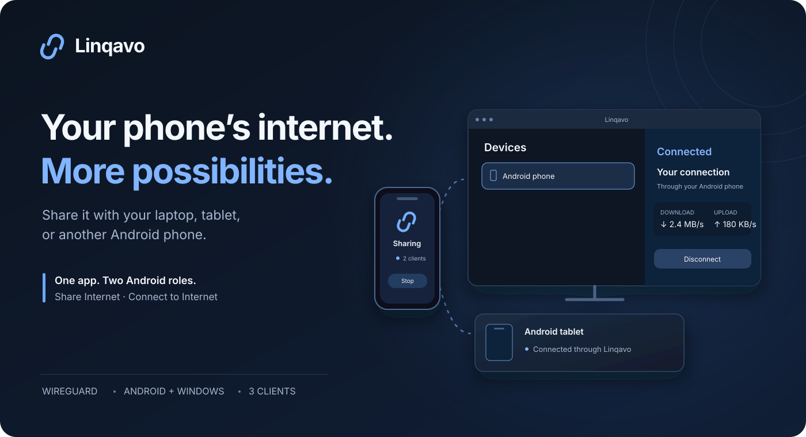
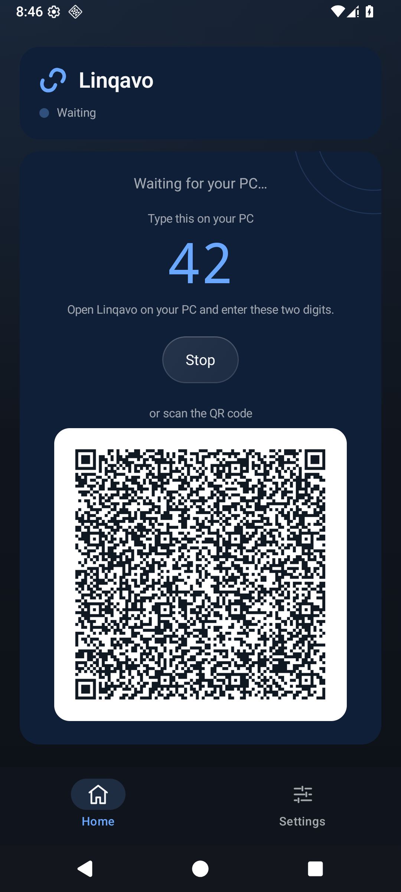
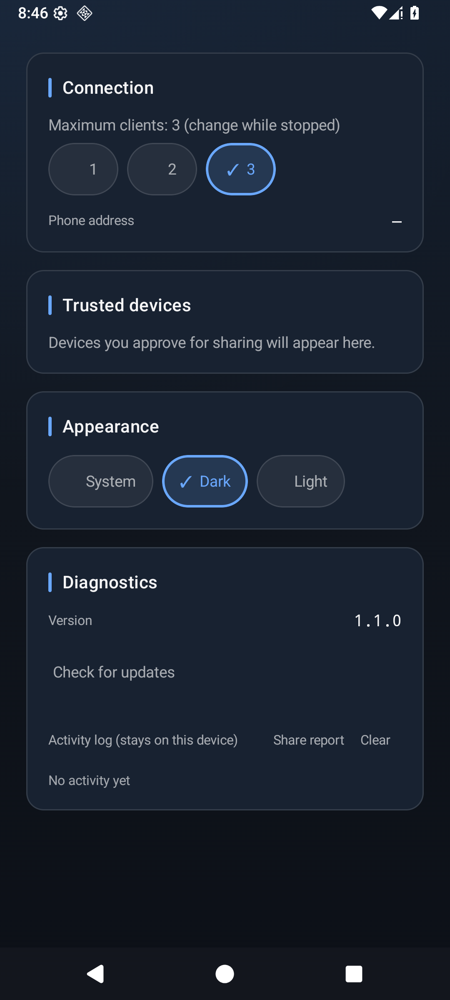

<a href="README.md">English</a> · <a href="README.es.md"><strong>Español</strong></a>

Android 8+ · Windows 10 / 11 · WireGuard · Hasta 3 clientes

Comparte la conexión de un teléfono Android con tu **PC Windows, una tablet u otro teléfono Android**. Usa la misma Wi-Fi o el punto de acceso del teléfono. Windows también puede usar el enlace local de anclaje USB.

**Una app Android, dos roles.** Elige Share Internet en el teléfono que comparte y Connect to Internet en otro Android. Cada cliente tiene su propia conexión WireGuard y su identidad guardada.

## Conectar

| 1 · Comparte | 2 · Elige el teléfono | 3 · Aprueba una vez |
| --- | --- | --- |
| Abre **Share Internet** e inicia la sesión. | En Windows, selecciona el teléfono, introduce su código o escanea el QR. En Android, abre **Connect to Internet** y selecciona el teléfono o escanea el QR. | Compara la huella completa cuando se solicite y aprueba el dispositivo nuevo en el teléfono que comparte. |

Los equipos de confianza conservan su identidad al reiniciar Compartir. Un dispositivo nuevo o una identidad revocada necesitan aprobación. Android solicita permiso de VPN para recibir Internet.

## Lo que añade Linqavo

| | |
| --- | --- |
| **Android → Android** | Comparte con una tablet u otro teléfono mediante el cliente VPN. Ambos roles están en el mismo APK. |
| **Laptop y tablet a la vez** | Autoriza hasta tres equipos con claves y direcciones IPv4 independientes. Gestiona el acceso de cada uno. |
| **Dispositivos de confianza** | Aprueba una vez y permite la reconexión. Administra los equipos recordados en Ajustes. |
| **Escritorio compacto** | Panel principal, Ajustes aparte, mini ventana de estado y menú de bandeja con el estilo de Linqavo. |
| **Diseño oscuro y azul** | Paneles azul marino, detalles legibles y pantallas Android de emparejamiento y Ajustes con la misma identidad. |
| **Tráfico y estado** | Velocidad, totales y estado que considera por separado el tráfico reenviado y la presencia autenticada. |

## Dentro de la app

<table>
<tr><th>Empareja una vez</th><th>Gestiona tus dispositivos</th></tr>
<tr>
<td align="center"></td>
<td align="center"></td>
</tr>
</table>

Capturas reales del emulador Android con datos ilustrativos. La portada es una ilustración de la interfaz.

## Seguridad y confianza

- **Emparejamiento TLS con certificado fijado.** Verifica el teléfono antes de intercambiar la clave pública. La primera conexión necesita aprobación.
- **Identidades WireGuard independientes** y reglas de dirección /32 por cliente.
- **Claves locales protegidas.** Android usa Keystore y Windows cifra la identidad para el usuario actual.
- **Control del acceso.** Desactivar conserva la autorización. Revocar invalida la clave. Olvidar exige otra aprobación desde la próxima sesión de Compartir.
- **Protección de rutas.** La VPN Android enruta IPv4 y bloquea IPv6 mientras está activa. Windows ofrece filtros DNS/IPv6 y mantener la ruta si se pierde el teléfono.
- **Operación local.** Sin cuentas de Linqavo, servidores intermediarios ni telemetría. Los diagnósticos se comparten por decisión del usuario.

Mantener la ruta en Windows tiene límites si falla el auxiliar o durante el establecimiento de la conexión. La comprobación física de fugas DNS/IPv6 sigue pendiente. El teléfono reenvía mediante su red predeterminada, según la política de Android.

[Emparejamiento](shared/enrollment-v2.md) · [Política de reenvío](shared/forwarding-policy.json) · [Cliente Android](shared/android-client.md)

## Descargar y usar

| Plataforma | Paquete |
| --- | --- |
| **Android ARM64** | [Descargar APK](https://github.com/STENDSTUDIOS/Linqavo/releases/download/v1.2.0/Linqavo-1.2.0-android-arm64-debug.apk). Incluye ambos roles y está firmado con clave de desarrollo. |
| **Windows x64** | [Descargar instalador](https://github.com/STENDSTUDIOS/Linqavo/releases/download/v1.2.0/Linqavo-Setup-x64-1.2.0.exe). Cierra la copia portátil anterior y ejecuta el instalador. Abre Linqavo desde Inicio. Para desinstalarlo, usa Configuración → Aplicaciones. El instalador carece de firma de editor. |

[Notas de la versión](https://github.com/STENDSTUDIOS/Linqavo/releases/tag/v1.2.0) · [Sumas SHA-256](https://github.com/STENDSTUDIOS/Linqavo/releases/download/v1.2.0/SHA256SUMS.txt)

Desde la 1.2, la app en primer plano consulta si hay una versión estable más reciente en GitHub. Pulsa **Actualizar** para descargarla y abre el instalador o el APK. También puedes buscar actualizaciones desde Ajustes. Usa los enlaces de arriba para este primer cambio de versión. Windows puede solicitar elevación para crear el adaptador. La interfaz ofrece inglés y persa. Android incluye temas oscuro, claro y del sistema.

## Validación

Las pruebas físicas anteriores confirmaron un S25 Ultra compartiendo simultáneamente con una Tab A11+ y un portátil Windows. En 1.1.0 se comprobó en emulador la reconexión de confianza tras reiniciar Compartir. Siguen pendientes la aceptación física de esta versión, tres clientes simultáneos, la protección de Windows ante cierres abruptos y las fugas DNS/IPv6.

## Desarrollado con IA

**Linqavo ha sido vibecoded.** Se utilizaron herramientas de IA para escribir y revisar código, diseñar la interfaz y preparar pruebas. Si te incomoda ese método de desarrollo, te recomendamos que no uses Linqavo.

## Créditos y licencia

Basado en **[Relay](https://github.com/Mahdi-mortazavi/relay)** de **Mahdi Mortazavi y sus colaboradores**. Su trabajo en Android, Windows y WireGuard hizo posible este proyecto.

El fork añade cliente Android, autorización independiente de varios equipos, confianza persistente, mejoras del ciclo de conexión y la identidad Linqavo. También utiliza WireGuard, wireguard-go, gVisor y Wintun. El paquete de Windows conserva las licencias de Wintun y del proyecto original.

Distribuido bajo la [licencia GNU GPL](LICENSE). [Compilar el proyecto](docs/BUILD.md).
