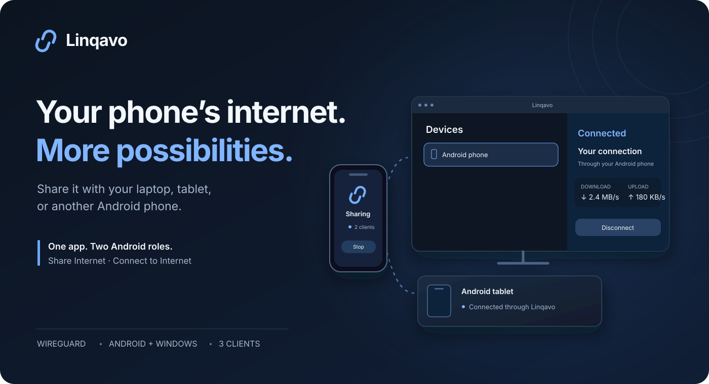
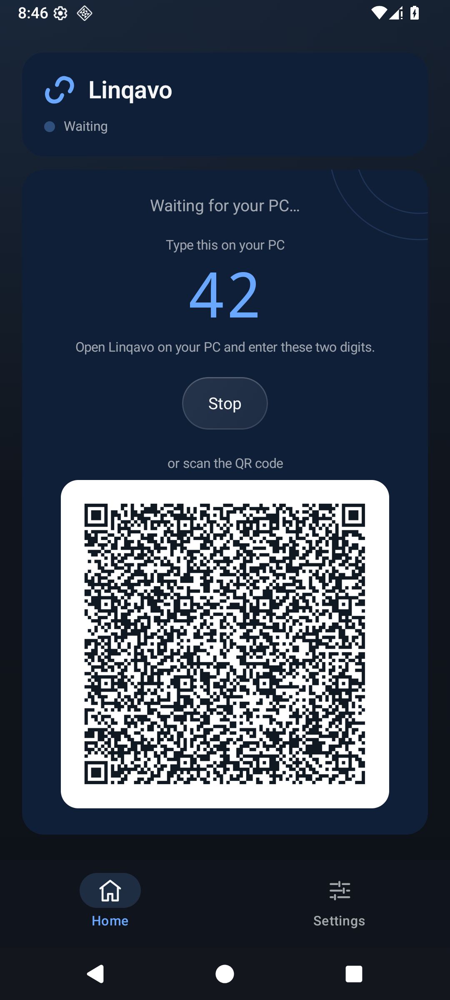
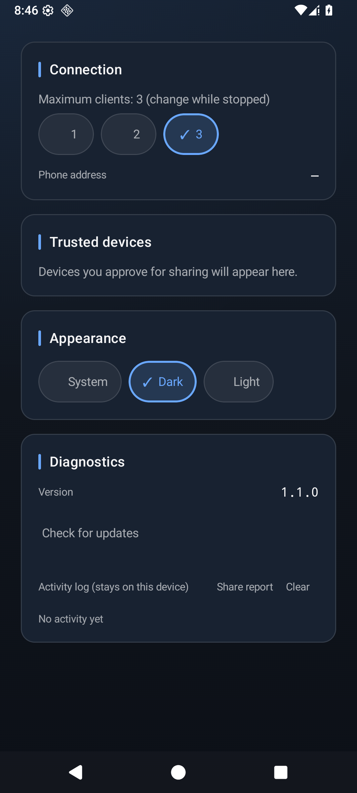

<a href="README.md"><strong>English</strong></a> · <a href="README.es.md">Español</a>

Android 8+ · Windows 10 / 11 · WireGuard · Up to 3 clients 
<a href="#get-connected">Get connected</a> · <a href="#what-linqavo-adds">Features</a> · <a href="#security-and-trust">Security</a> · <a href="docs/BUILD.md">Build from source</a>

Share an Android phone’s internet with your **Windows PC, Android tablet, or another Android phone**. Connect over your local Wi-Fi or the phone’s hotspot. Windows can also use USB tethering as the local link.

**One Android app, two roles.** Share Internet on the phone. Connect to Internet on another Android device. Each client gets its own encrypted WireGuard connection and saved identity.

## Get connected

| 1 · Start sharing | 2 · Choose your phone | 3 · Approve once |
| --- | --- | --- |
| Open **Share Internet** on the Android phone that has internet. | On Windows, choose the discovered phone, enter its pairing code, or scan its QR. On Android, open **Connect to Internet** and choose the phone or scan its QR. | Compare the full fingerprint when prompted, then approve the new device on the sharing phone. It joins your trusted devices. |

Returning trusted clients keep their identity across sharing restarts. A new device or a revoked identity needs approval. Android asks for system VPN consent when connecting as a client.

## What Linqavo adds

| | |
| --- | --- |
| **Android → Android** | Give a tablet or another phone access through the Android VPN client. Sharing and connecting are built into the same APK. |
| **Your laptop and tablet together** | Authorize up to three clients with independent keys and IPv4 addresses. Disable or revoke one device individually. |
| **Trusted devices** | Approve a device once, then let it reconnect. Manage remembered devices in Settings. |
| **A quieter desktop** | A full dashboard, separate Settings, a compact connection window, and a themed tray menu. |
| **A consistent dark interface** | Navy panels, blue accents, readable connection details, and matching Android pairing and Settings screens. |
| **Traffic and connection status** | Live counters, transfer totals, and state that considers forwarding evidence separately from authenticated presence. |

## Inside the app

<table>
<tr><th>Pair once</th><th>Manage your devices</th></tr>
<tr>
<td align="center"></td>
<td align="center"></td>
</tr>
</table>

Actual Android emulator captures. Pairing data is illustrative. The cover is an interface illustration.

## Security and trust

- **Pinned TLS enrollment** verifies the sharing phone before exchanging the client’s public key. A first-time connection needs explicit approval.
- **Independent WireGuard identities** and per-client /32 address rules keep authorization separate for each device.
- **Protected local keys.** Android uses Android Keystore. Windows encrypts its saved client identity for the current Windows user.
- **Control over access.** Disable preserves authorization for re-enabling. Revoke invalidates the key. Forget removes automatic access from the next sharing session.
- **Routing protections.** The Android VPN routes IPv4 and blocks IPv6 while active. Windows offers DNS/IPv6 filters and an option to hold the tunnel route during phone loss.
- **Local operation.** No Linqavo accounts, relay servers, or telemetry. Diagnostics stay on the device until you choose to share them.

Windows route holding has limits during helper crashes and connection setup. Physical IPv6/DNS leak verification remains pending. The phone forwards through its default network according to Android’s routing policy.

[Enrollment contract](shared/enrollment-v2.md) · [Forwarding policy](shared/forwarding-policy.json) · [Android VPN behavior](shared/android-client.md)

## Download and use

| Platform | Package |
| --- | --- |
| **Android ARM64** | [Download APK](https://github.com/STENDSTUDIOS/Linqavo/releases/download/v1.2.0/Linqavo-1.2.0-android-arm64-debug.apk). Both roles are included. Signed with a development key. |
| **Windows x64** | [Download Windows Setup](https://github.com/STENDSTUDIOS/Linqavo/releases/download/v1.2.0/Linqavo-Setup-x64-1.2.0.exe). Exit the old portable copy and run Setup. Open Linqavo from Start. To remove it, use Windows Settings → Apps. The installer is unsigned. |

[Release notes](https://github.com/STENDSTUDIOS/Linqavo/releases/tag/v1.2.0) · [SHA-256 checksums](https://github.com/STENDSTUDIOS/Linqavo/releases/download/v1.2.0/SHA256SUMS.txt)

Starting with 1.2, the foreground app checks GitHub for a newer stable version. Choose **Update** to open the official download, then run Setup or open the APK. Settings also offers a manual check. Install this first upgrade from the links above. Windows may request elevation to create its network adapter. The interface supports English and Persian. Android offers dark, light, and system themes.

## Validation

Earlier physical testing confirmed a Galaxy S25 Ultra sharing simultaneously with a Galaxy Tab A11+ and a Windows laptop. For 1.1.0, emulator testing verified trusted-client reconnection after restarting sharing. Physical acceptance of this release, three simultaneous clients, crash-safe Windows protection, and DNS/IPv6 leak verification remain open.

## Built with AI

**Linqavo is vibecoded.** AI tools helped write and review code, design the interface, and prepare tests. If you are uncomfortable using software developed this way, please do not use Linqavo.

## Credits and license

Linqavo is based on **[Relay](https://github.com/Mahdi-mortazavi/relay)** by **Mahdi Mortazavi and its contributors**. Their Android and Windows apps and WireGuard foundation made this project possible.

The fork adds Android client mode, independent multi-client authorization, persistent trust, lifecycle work, and the Linqavo visual identity. It also relies on WireGuard, wireguard-go, gVisor, and Wintun. The Windows package includes Wintun’s license and the original project’s license.

Distributed under the [GNU GPL](LICENSE). [Build instructions](docs/BUILD.md).
